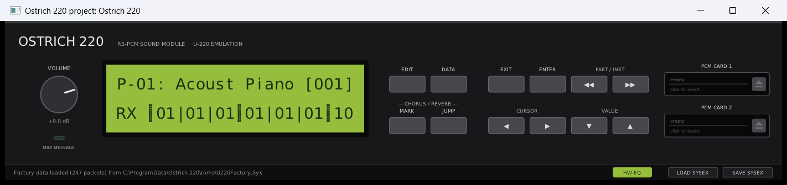
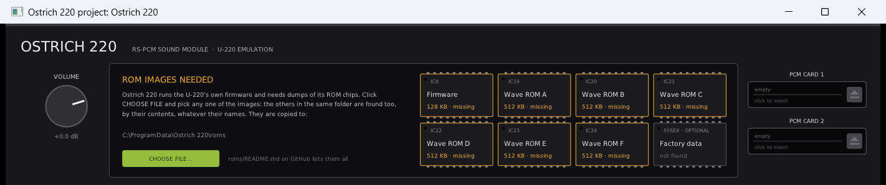

# Ostrich 220 (O-220)

An emulation of the **Roland U-220 RS-PCM Sound Module** (1989) as a VST3/CLAP plugin and a
standalone program, plus a U-220 driver for MAME. A non-commercial fan project.

The emulation runs the U-220's **original firmware** on an emulated CPU, with the sound chips
emulated after the hardware. Everything the firmware does comes along by itself: voice
allocation, the six parts and the rhythm part, MIDI, SysEx, the menus, the display.

You need your own ROM images. **This repository contains no Roland data and never will.**

**[Download Ostrich 220](https://github.com/Helge666/ostrich220/releases/latest)** (Windows
and Linux; see [Download](#download) below).

## What it does

- **The U-220 itself.** All 128 tones and 64 patches (with the factory data), the 24×2 display
  and the twelve panel keys, played by mouse. The battery-backed memory is saved with the
  host session.
- **Reverb/delay and chorus**, measured on a real U-220 and rebuilt (see below).
- **Outputs as on the unit:** MIX OUT, DIRECT OUT 1 and DIRECT OUT 2 as three stereo pairs.
  A part assigned to Dir1/Dir2 sounds there, without effect, once the host's output is
  switched on; otherwise it joins MIX, as on the unit with nothing plugged in.
- **Two PCM card slots** for SN-U110 card dumps. Click a slot to insert a card (a dump, or
  its zip from MAME's software list), the eject button takes it out; the firmware notices
  either while running ("Checking PCM Card..."). A dump known to be good shows its card's
  number with a check mark. Only the file's path is saved with the session.
- **SysEx files:** SAVE SYSEX writes the unit's own bulk dump (Data > Bulk > All) to a
  `.syx`; LOAD SYSEX sends a `.syx` into the machine.
- **MIDI OUT:** what the firmware sends appears on the plugin's MIDI output.
- **HW-EQ:** the measured analogue output stage (default on); off gives the raw core.

Formats: VST3, CLAP and a standalone program on Windows (64-bit); VST3, CLAP and a JACK
standalone on Linux. No macOS build.

## Download

**[Download the latest version](https://github.com/Helge666/ostrich220/releases/latest)** —
no compiling needed.

On that page, under **Assets**, click `Ostrich220-Windows.zip` (or `Ostrich220-Linux.zip`)
to download it, then unzip it. The zip contains the plugin, the standalone program and an
`INSTALL.txt` with the same steps as below. (The "Source code" links there are only needed
for building it yourself.)

## Installing (Windows)

1. Copy `Ostrich220.vst3` to `C:\Program Files\Common Files\VST3\` (or
   `%LOCALAPPDATA%\Programs\Common\VST3\`), or `Ostrich220.clap` to the CLAP folder.
2. Load Ostrich 220 in your DAW (or start `Ostrich220.exe`). The first time, it asks for
   the ROM images:

   

   Click **CHOOSE FILE** and pick any one of your U-220 ROM images, or a zip with them
   (MAME's `u220.zip` will do; zips beside it, such as `u110.zip`, are searched too).
   Ostrich 220 finds the others in the same folder by their contents, whatever their
   names, copies them to `C:\ProgramData\Ostrich 220\roms\` and starts. If some are in
   another folder, click again and pick one of those. Which images you need:
   [roms/README.md](roms/README.md).
3. Optional: a U-220 factory SysEx dump whose name starts with `U220Factory` (`.syx`) in
   the same folder (or zip) comes along. A new instance then starts like a unit fresh from
   the factory, with the 64 factory patches. Without it a new instance runs Memory
   Initialize, as a unit does that has lost its memory: playable, but with the firmware's
   default settings instead of the factory patches.

You can also copy the images to `C:\ProgramData\Ostrich 220\roms\` yourself. The status
line under the panel says which ROMs were found and where, or which are missing and where
they were looked for. Folders searched, in this order, for "Ostrich 220" and then
"Ostrich": `%PROGRAMDATA%\…\roms`, `%LOCALAPPDATA%\…\roms`, `Documents\…\roms`; on Linux
`$XDG_DATA_HOME/…/roms`, `~/.local/share/…/roms`, `/usr/share/…/roms`. The environment
variable `OSTRICH_ROMS` names a folder searched first.

## The effects are an approximation

The U-220's reverb, delay and chorus come from a dedicated effect processor (IC25, Toshiba
TC23SC140AF) whose program nobody has documented. Ostrich 220 does not emulate it: it
replaces it with a model fitted to measurements of a real U-220 (decay per octave band,
levels, delay times, chorus modulation) and checked by ear in A/B tests. It is close, but
it is not the chip. The effect model is one module behind a narrow interface, to be
replaced if the chip is ever understood. See [analysis/U220-EFFECTS.md](analysis/U220-EFFECTS.md).

Individual units may also differ a little, from ageing analogue parts.

## Known limitations

- **SysEx out of the VST3 does not reach Cubase.** The plugin hands the messages to the
  host; Cubase 15 neither records nor forwards them. Use SAVE SYSEX instead. Other hosts
  and CLAP are untested.
- **No SysEx into the VST3.** DPF's VST3 wrapper does not accept SysEx input. Use LOAD
  SYSEX instead.
- **Tested:** the Windows VST3, in Cubase 15. The Windows standalone has seen little use.
  The Windows CLAP and all Linux builds are **untested**: they build, and an automatic
  test loads the Linux CLAP once, but nobody has used them yet. Reports welcome.
- In MAME the display exists only as text in the log (the LCD controller's character ROM
  has never been dumped).

## Building

[BUILDING.md](BUILDING.md). The U-220 in MAME: [RUNNING.md](RUNNING.md). What is known
about the hardware: [analysis/](analysis/README-ANALYSIS.md). What is planned:
[ROADMAP.md](ROADMAP.md).

## Origin

Ostrich 220 is based on **[emu110 / Voltaire 110](https://github.com/eliggett/emu110)** by
Elliott H. Liggett, an emulation of the Roland U-110. The U-110 and U-220 share the PCM
chips (MB87419/MB87420), wave ROMs A–D and the card format, so this project builds directly
on emu110's work: its MAME device work, its plugin core and its analyses. The starting point
was emu110 commit `5990a16` ([`.upstream-base`](.upstream-base)).

The history was started afresh rather than forked, because emu110 carries Roland ROM images
in its history; Ostrich 220 contains no Roland file, not even in the past.
[`tools/sync_upstream.sh`](tools/sync_upstream.sh) brings in emu110 updates.

Submodules:

| Path | Source | What for |
|---|---|---|
| `mame/` | [Helge666/mame](https://github.com/Helge666/mame), branch `u220` (a fork of emu110's `eliggett/mame`) | CPU, PCM chip, the `roland_u220` driver, IC25 mixer |
| `plugin/dpf/` | [DISTRHO/DPF](https://github.com/DISTRHO/DPF), with the patches in `plugin/patches/` | plugin framework |

## Licences

- The plugin (`plugin/ostrich`), the tools (`plugin/tools`, `tools/`): GPL-3.0-or-later, as
  emu110.
- The emulation core (`plugin/core`), the MAME devices and drivers: BSD-3-Clause, so that
  findings can flow back into MAME.
- Third-party code and its licences: [THIRD-PARTY.md](THIRD-PARTY.md). See [LICENSE](LICENSE).

"Roland", "U-220" and "U-110" are trademarks of Roland Corporation. This project is not
affiliated with Roland.
